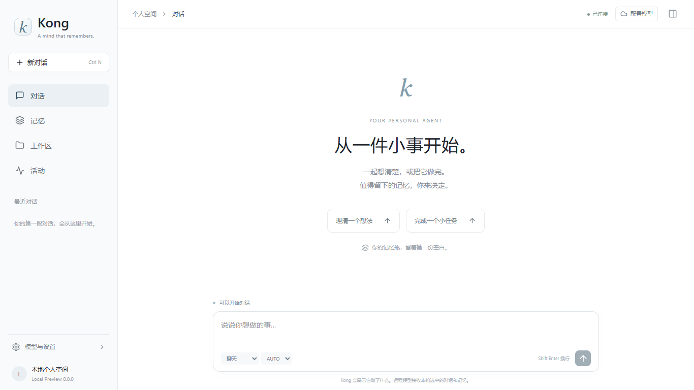

# Kong-Agent

一个带长期记忆的个人本地 Agent。你可以在浏览器、命令行或终端界面中与它对话、管理记忆、完成文件任务；模型提出决策，Runtime 负责授权、执行、保存证据和核验结果。

**当前版本：Kong Local Preview `0.0.0` · Python Runtime `0.5.0rc1` · MIT。** 本次作为预发布候选交付，主要面向 Windows 本地使用。



截图展示未配置模型、没有记忆和历史的新空间。实际使用需要配置模型；未配置时界面会提示设置。

## 可以做什么

| 能力 | 当前实现 |
|---|---|
| 多轮对话 | GUI、CUI、TUI 共用 Application Service 和已有 Runtime，保留对话、Run 状态与事件。 |
| 文件任务 | 调用工作区文件工具；调用方确认验收文件和准确内容后，Completion Gate 核对实际产物。 |
| 计划与人工控制 | FAST / AUTO / PLAN；PLAN 等待具体修订的批准，支持补充约束、取消、纠偏和显式恢复。 |
| 长期记忆 | 独立 SQLite Memory Core，支持明确保存、更正、来源查看、作用域检索和遗忘预览。 |
| 记忆瓶 | 展示真实 Core 记录，支持珍藏、启停和授权分页；瓶内最多呈现 24 个代表碎片。 |
| 运行检查 | 查看工具、证据、用量、实际文件和记忆请求轨迹；区分答复结束、任务验收通过与等待用户。 |
| 可选工具与技能 | 内置八类技能；原 CLI 可显式启用本机进程、终端、浏览器、MCP 和 Docker 进程后端。 |

## 在 Windows 上启动

需要 **Python 3.12+、uv 和浏览器**。首次安装依赖需要网络。GUI 的构建资源已经随源码和 wheel 提供，直接使用不需要 Node.js。

在 PowerShell 中将项目放到你的项目目录，例如：

```powershell
cd E:\Projects
git clone https://github.com/mrk-temple/Kong-Agent.git
cd .\Kong-Agent
.\scripts\start-local-preview.ps1
```

启动脚本安装锁定的 `local` / `tui` 依赖，仅监听 `127.0.0.1`，打开短期配对链接。数据、临时文件和缓存默认位于本项目 `.local-preview/` 中。按 Ctrl+C 停止服务。

首次进入“模型与设置”，填写 Provider、Base URL、Model ID 和 API Key，再主动检查连接。模型需支持 Chat Completions 兼容接口，并能够输出 Kong 要求的结构化决策。检查连接和发送消息都会产生实际模型请求。

API Key 仅保留在后端当前进程，重启后重新输入。也可使用本地 `kong.local.toml` 与其指定的环境变量，配置示例见 [kong.example.toml](kong.example.toml) 和 [.env.example](.env.example)；程序不会自动加载 `.env`。

独立入口：

```powershell
.\scripts\start-local-preview.ps1 -Action chat
.\scripts\start-local-preview.ps1 -Action tui
.\scripts\start-local-preview.ps1 -Action memory
```

TUI 用 Ctrl+Q 退出。一个数据目录只运行一个服务；同时使用多个界面的方法见 [用户指南](USER_GUIDE.md)。

## 不调用模型的体验

安装后可运行固定决策演示，无需密钥：

```powershell
uv run --frozen --extra local --extra tui kong --global-memory-db .\.local-preview\demo-memory.db demo --auto-approve
```

演示在独立目录中创建文件、读取验证并通过内容验收。去掉 `--auto-approve` 可审阅计划并输入 `/approve 1`。它用于检查安装和控制流程；真实模型的能力需另行评测。

## 三个使用约定

1. **记忆由你确认。** 默认 capture off；对话或模型说“已记住”不能代替 Core 保存成功的回执。保存、更正和遗忘见 [记忆指南](MEMORY_GUIDE.md)。
2. **任务按你确认的条件验收。** 文件存在或工具成功不足以证明任务完成；缺少强验收条件时需要补充条件。普通对话的“答复结束”也不等于文件任务完成。
3. **恢复先核对实际效果。** 结果未知的动作不会自动重放；先检查工作区，说明真实结果并解决未决动作，再显式继续。

本地预览默认只开放受限文件工具、历史召回和技能读取。强工具需要显式启用。本机工具使用当前用户权限；文件作用域控制不能代替操作系统沙箱。

## 工程结构

```text
src/kong/
  application/   共享服务、命令回执、事件、Memory Bridge
  local_api/     本地 HTTP / SSE、配对授权、内置前端
  tui/           Textual 终端界面
  runtime/       决策循环、批准、预算、完成门和恢复
  memory/        独立记忆领域、SQLite、检索和形成候选
  continuity/    上下文编译、来源检查和记忆预算
  tools/ skills/ 工具与内置技能
  evaluation/    独立评测和版本验收
web/             React / TypeScript 前端源码与依赖锁
scripts/         Windows 启动入口
tests/ examples/ 工程测试、离线演示和显式实模评测入口
```

模型 → 结构化 Decision → Runtime 授权 → 工具执行 → Observation 证据 → Completion Gate。GUI、CUI、TUI 通过同一应用层调用这条闭环，Memory Core 独立持久化。详见 [架构](ARCHITECTURE.md) 和 [恢复说明](RECOVERY.md)。

## 验证与当前限制

本次发布重新运行离线工程测试、前端测试与构建、固定发布回归、源码/安装包扫描及源码目录外安装核验。逐项结果与历史模型评测的边界见 [EVALUATION](EVALUATION.md)，发布检查见 [PUBLIC_RELEASE_CHECKLIST](PUBLIC_RELEASE_CHECKLIST.md)。

Local Preview 的既有实模样本观察到事实保存、跨 Thread 回忆、更正和遗忘流程可运行，也发现格式遵循、保存话语和计划步骤证据存在问题。这些历史样本不构成当前修整版本的完整实模验收。本次修整不追加收费模型请求。

当前还缺少真人长期使用、新机器和跨平台的完整验收。Core 遗忘的范围不包括旧 Runtime 历史、已外发请求、导出和备份；详细范围见记忆指南。

## 文档与开发

- [用户指南](USER_GUIDE.md)：对话、任务、审批、恢复和三个入口。
- [记忆指南](MEMORY_GUIDE.md)：保存授权、记忆瓶、来源和遗忘范围。
- [开发指南](DEVELOPMENT.md)：环境、测试、前端构建、源码身份和打包。
- [版本说明](RELEASE_NOTES.md) / [Changelog](CHANGELOG.md)：本次交付及历史变化。
- [GitHub Releases](https://github.com/mrk-temple/Kong-Agent/releases)：预发布安装包和源码快照。

项目采用 [MIT License](LICENSE)。本地模型配置、凭据、数据库、缓存、原始日志和内部开发记录保留在本地，不随源码快照或发行包交付。
